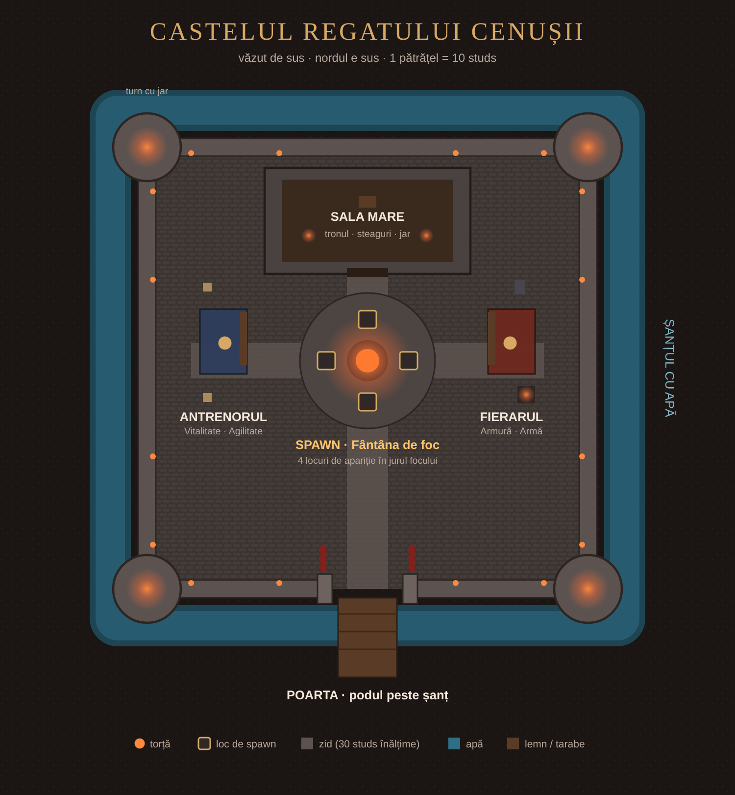

# Regatul Cenușii pe Roblox

Prima parte: **castelul**, adică spawnul jocului, și **negustorii** la care dai upgrade la armură și la caracter.

## Ce e aici

| Fișier | Unde merge în Roblox Studio | Ce face |
|---|---|---|
| `build/ConstruiesteCastelul.lua` | **Command Bar** (rulat o dată) | Construiește castelul: teren, șanț, ziduri, turnuri, poartă, curte, Sala Mare, tarabele, torțele și lumina de amurg. |
| `src/ServerScriptService/CastelEconomie.server.lua` | **ServerScriptService** → un `Script` | Oboli, upgrade-uri, salvare, verificarea cumpărăturilor. |
| `src/StarterPlayerScripts/MagazinCastel.client.lua` | **StarterPlayer → StarterPlayerScripts** → un `LocalScript` | Fereastra negustorilor. |

## Pașii, pe rând

1. Deschide Roblox Studio și fă un joc nou (**Baseplate** e bun, scriptul îl șterge oricum).
2. **Castelul**: View → **Command Bar**. Copiază tot `ConstruiesteCastelul.lua`, lipește-l în Command Bar și apasă **Enter**. În câteva secunde apare castelul, iar în Output scrie „Castelul Regatului Cenușii e gata”.
3. **Economia**: în Explorer, click dreapta pe **ServerScriptService** → Insert Object → **Script**. Redenumește-l `CastelEconomie` și lipește în el `CastelEconomie.server.lua`.
4. **Fereastra magazinului**: StarterPlayer → **StarterPlayerScripts** → Insert Object → **LocalScript**. Redenumește-l `MagazinCastel` și lipește `MagazinCastel.client.lua`.
5. **Salvarea progresului**: Game Settings → **Security** → pornește *Enable Studio Access to API Services*. Fără asta merge tot, dar progresul nu se păstrează între sesiuni de test.
6. Apasă **Play**. Apari în curte, lângă fântâna de foc. Mergi la Fierar sau la Antrenor și apasă **E**.
7. **File → Publish to Roblox** ca să rămână salvat.

Scriptul de castel se poate rula din nou oricând: șterge castelul vechi și îl face din nou, curat.

## Ce poți cumpăra

| Negustor | Upgrade | Ce face | Nivel maxim |
|---|---|---|---|
| Fierarul Cenușii | 🛡️ Armură | -5% daune primite pe nivel | 10 |
| Fierarul Cenușii | ⚔️ Armă | +8% daune date pe nivel | 10 |
| Antrenorul Regelui | ❤️ Vitalitate | +20 viață maximă pe nivel | 10 |
| Antrenorul Regelui | 💨 Agilitate | +1,5 viteză de mers pe nivel | 8 |

Prețul crește cu fiecare nivel. Fiecare jucător începe cu 100 de Oboli și primește 15 Oboli pe minut cât stă în joc (până vin monștrii și luptele). Armura și Arma se salvează pe personaj ca atribute (`Armura`, `Arma`), gata pentru sistemul de luptă.

## Ce urmează

- Zonele din afara castelului: Pădurea de Scrum, Mlaștinile Umbrei, Ruinele Abisului, cu monștri care dau Oboli.
- Legătura cu botul de Discord: topul jucătorilor de Roblox în Discord, legarea contului, roluri.
